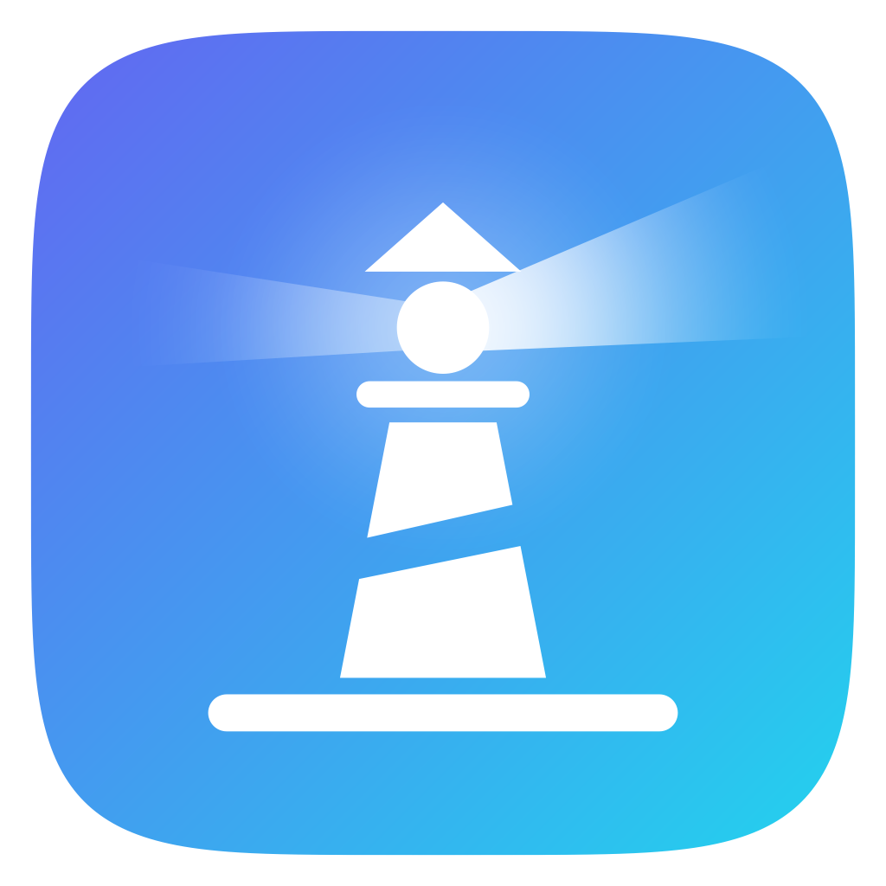
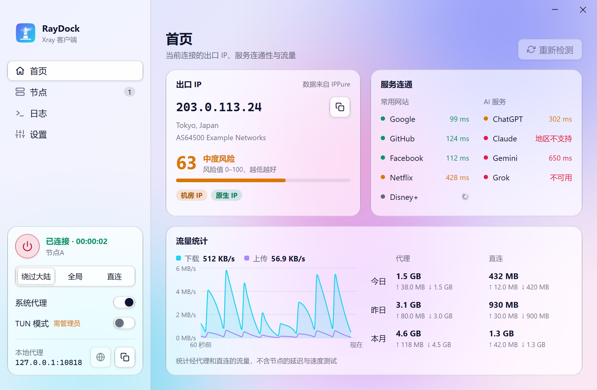

<p align="center">
  
</p>
<h1 align="center">RayDock</h1>
<p align="center">基于 Xray-core 的 Windows 代理客户端，使用 Go 与 MyGo 原生自绘 UI 构建。</p>
<p align="center">
  <a href="https://github.com/jnnbimo/RayDock/releases"></a>
  
  <a href="LICENSE"></a>
</p>
<p align="center">
  <a href="https://github.com/jnnbimo/RayDock/releases/latest">下载</a> ·
  <a href="#快速使用">快速使用</a> ·
  <a href="#从源码构建">源码构建</a> ·
  <a href="https://github.com/jnnbimo/RayDock/issues">问题反馈</a>
</p>


<p align="center"><sub>界面预览使用示例节点和模拟测试结果，不包含真实连接信息。</sub></p>

## 特性

- **原生玻璃界面**：浅色、深色及跟随系统；无 GPU 时也保留玻璃效果。
- **多协议支持**：VLESS、VMess、Trojan、Shadowsocks、Hysteria2、SOCKS5、HTTP / HTTPS、WireGuard；高级出站可通过 Xray JSON 导入。
- **节点与订阅**：支持分享链接、Base64 订阅、Clash / Mihomo YAML，提供分组管理、拖动排序、节点编辑和二维码分享。
- **系统代理与 TUN**：支持绕过大陆、全局、直连，以及自定义域名、IP、进程规则和 DNS。
- **代理链与专用端口**：按分组设置前置 / 后置代理，为不同节点分配独立的本地端口。
- **首页概览**：出口 IP 的位置、类型与风险值，常用网站与 AI 服务的连通性，实时速率与每日 / 每月的代理、直连流量。
- **连接测试与桌面集成**：测延迟、查出口 IP、上传 / 下载测速，支持托盘控制和开机自启。

> 目前面向 **Windows x64（amd64）**。RayDock 不提供节点或订阅服务，需要自行准备可用配置。

## 下载

前往 [Releases](https://github.com/jnnbimo/RayDock/releases/latest) 下载：

| 文件 | 用途 |
| --- | --- |
| `RayDock-Setup-<版本>-amd64.exe` | 安装版，按向导安装 |
| `RayDock-<版本>-windows-amd64-portable.zip` | 绿色版，完整解压后运行 `RayDock.exe` |
| `RayDock-<版本>-SHA256SUMS.txt` | 文件校验清单 |

发行包自带 Xray、Wintun 和完整规则数据。绿色版请保留 `RayDock.exe`、`icon.png`、`core/` 以及附带的许可证文件，不要只复制可执行文件。

## 快速使用

1. 点击「添加节点」粘贴配置，或通过「添加分组 → 订阅分组」添加订阅。
2. 选中节点，点击侧栏连接开关。
3. 按需开启「系统代理」或「TUN 模式」；**TUN 需要管理员权限**。
4. 在侧栏切换路由模式。连接中的待应用设置需点击顶部「应用」。

默认本地代理为 **`127.0.0.1:10818`**，HTTP 与 SOCKS5 共用该端口。节点右键菜单提供编辑、测速、测延迟、节点分享（二维码与链接）及专用端口设置；分组编辑中可配置代理链。

关闭窗口后仍在托盘运行。完全退出请使用托盘菜单中的「退出 RayDock」。

### 使用须知

- **数据位置**：安装版和绿色版默认都使用 `%APPDATA%\RayDock`，可在「设置 → 关于」打开。绿色版不是配置随包的隔离实例。
- **保护凭据**：配置文件含节点密码和订阅地址，并非加密密码库；备份前先退出程序，反馈问题时请隐藏敏感信息。
- **局域网访问**：代理端口不提供入站认证，仅在可信网络开放，并用防火墙限制来源。
- **导入范围**：Clash / Mihomo 仅导入受支持的节点，不导入规则与代理组；订阅节点的手动修改可能被下次更新覆盖。
- **更新与连接**：核心和规则数据分别手动更新，更新核心不会覆盖已有规则。规则下载不影响当前连接，最终替换会与核心启动、测试任务串行进行。手动换节点或重建 TUN 会中断已有连接。
- **流量统计**：正常断开、切换与退出会在停止后端前尝试结算最后一次采样；核心崩溃、采样接口不可用或强制结束程序仍可能丢失未结算数据，统计不用于精确计费。
- **更新恢复**：替换或回滚失败时，日志会给出 `core/rollback-*` 恢复备份的位置；这些目录不会被后续更新自动删除。已成功替换的旧文件使用 `retired-*` 标记，在不再被进程占用后自动回收。
- **证书与测试**：自动固定证书属于首次使用时信任，优先使用有效证书或可信指纹；测速会消耗流量，延迟与出口 IP 查询会访问第三方测试服务；打开首页时会经当前连接访问 IPPure（出口 IP 信息）以及所列网站和 AI 服务的接口。

## 从源码构建

需要 **Windows x64、Go 1.27.3 或更新版本**，以及获取 Go 依赖和 GitHub 下载资源的网络环境。在项目根目录运行：

```powershell
$env:CGO_ENABLED = "0"
go mod download
go run ./cmd/fetchcore
go tool mygo build
```

`fetchcore` 准备核心和完整规则数据，已有可用资源时跳过下载，`-force` 可重新获取。产物位于 `build/windows-amd64/`，包含可执行文件和 NSIS 安装包；绿色包需另行压缩。准备好资源后，可用 `go run .` 开发运行。

### 验证

```powershell
$env:CGO_ENABLED = "0"
go test ./...
go vet ./...
go tool mygo vet .
go tool mygo vet ./internal/gui

# Integration tests require the prepared core and a suitable network environment.
$env:RAYDOCK_CORE_DIR = (Resolve-Path .\resources\windows-amd64\core).Path
go test -tags integration ./internal/app ./internal/xray -run Integration -v
```

源码主要分为 `internal/app`（应用逻辑）、`internal/gui`（界面）、`internal/xray`（核心配置与管理）和 `internal/node`（节点解析）。版本及打包配置见 [mygo.json](mygo.json)。构建输出和下载生成的核心资源不提交到源码仓库，发行文件放在 Releases。

## 许可与致谢

RayDock 自身源码采用 [MIT License](LICENSE)。第三方组件与数据遵循各自许可，详见 [第三方许可说明](THIRD_PARTY_NOTICES.txt)。

感谢 [Xray-core](https://github.com/XTLS/Xray-core)、[MyGo](https://github.com/egoist/mygo)、[Wintun](https://www.wintun.net/) 和 [Loyalsoldier/v2ray-rules-dat](https://github.com/Loyalsoldier/v2ray-rules-dat)。
